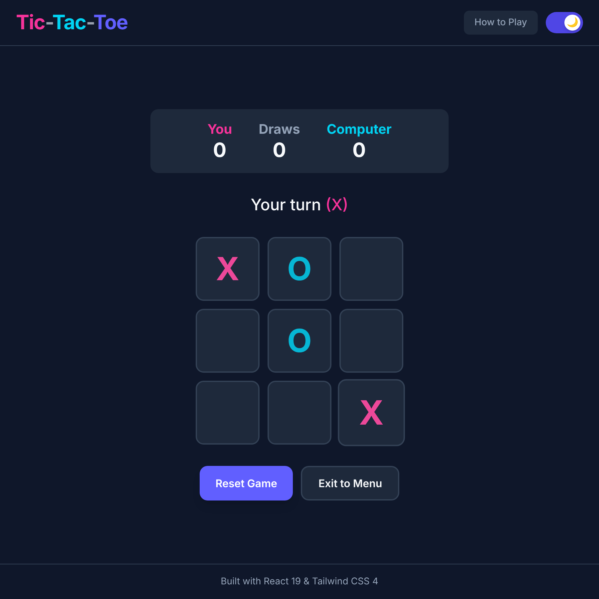

<div align="center">

# ❌⭕ Tic-Tac-Toe

### The oldest game on the napkin, rebuilt for people who refuse to lose to a napkin. 🧻🔥

**Three in a row. Zero chill. One computer that has never lost a game.**

[](https://github.com/pacphi/tic-tac-toe/actions/workflows/ci.yml)


<picture>
  <source media="(prefers-color-scheme: dark)" srcset="docs/screenshot-dark.png">
  <source media="(prefers-color-scheme: light)" srcset="docs/screenshot-light.png">
  
</picture>

</div>

---

## 🤔 Wait, *another* tic-tac-toe?

Yes. Hear us out. 🙋

Every kid learns tic-tac-toe, works out that it always ends in a draw, and quits by age eight. We took that solved, ancient and frankly smug little game, put it in neon, wrapped it in dark mode, and added an opponent that has **read the ending**. 📖

You won't beat it. Draw it and you can brag. That's the whole hook. 🎣

## ✨ Features

| | |
|---|---|
| 🤖 **The Unbeatable Machine** | A minimax engine with alpha-beta pruning works through every possible future before it moves. It has never lost. Getting a draw is your best possible result, so take it with pride. |
| 👥 **Couch Co-op Chaos** | Two humans, one screen, no AI to hide behind. Settle the dishes argument the old-fashioned way. 🍽️ |
| 🏆 **Scoreboard of Shame** | Wins, losses and draws pile up across rounds. Hitting reset keeps your score; picking a new game mode wipes it. |
| 🌗 **Light / Dark Mode** | Follows your system setting and remembers your choice. Your eyes deserve nice things. 😎 |
| 🎨 **Neon Glow-Up** | Hot-pink X's, cyan O's, and a winning line that lights up so you know exactly how you lost. |
| 📖 **Built-in Rules** | A "How to Play" pop-up for the three people on Earth who need it. No judgement. Okay, a little judgement. |
| ⚡ **Instant Everything** | Vite 8 and its Rust-powered Rolldown bundler build it in about 200 ms, the page loads straight away, and the computer pauses for half a second so it looks like it's thinking. 💅 |

## 🚀 Quick Start

You'll need [Node.js](https://nodejs.org/) 22 or 24. That's it. ✌️

```bash
git clone https://github.com/pacphi/tic-tac-toe.git
```

```bash
cd tic-tac-toe
```

```bash
npm install
```

```bash
npm run dev
```

Then open **http://localhost:5173** and get humbled. 🫠

## 🎮 How to Play

1. 🎯 **Pick a mode:** 🤖 *vs Computer* (bring snacks and humility) or 👥 *vs Friend* (bring trash talk).
2. ❌ **X always goes first.** That's you.
3. 🖱️ **Click an empty square** to drop your mark.
4. 🏁 **Get three in a row** across, down or diagonally. Or, against the computer, try not to lose. 😅
5. 🔁 **Play Again** for the next round, or **Exit to Menu** to switch modes.

> 💡 **Pro tip:** take the center or a corner on your first move. The computer will still hold you to a draw, but at least you'll go down like a legend.

## 🧠 Under the Hood

| Layer | Tech | Why it's here |
|---|---|---|
| 🎨 UI | [React 19](https://react.dev/) | Small components, one custom hook, no global state |
| 💄 Styling | [Tailwind CSS 4](https://tailwindcss.com/) | Utility classes plus CSS variables that drive the theme |
| ⚡ Build | [Vite 8](https://vite.dev/) + [Rolldown](https://rolldown.rs/) | Instant dev server, production builds in about 200 ms |
| 🤖 Brains | Minimax + alpha-beta pruning | Pure JavaScript, no dependencies, unbeatable |
| 🧪 Tests | [Vitest](https://vitest.dev/) + [Testing Library](https://testing-library.com/) | 23 tests, including one where the AI plays itself to a draw |
| 🧹 Quality | [ESLint](https://eslint.org/) + [TypeScript](https://www.typescriptlang.org/) type checking | Catches mistakes before the computer can laugh at them |

Want to poke at the internals? Start here 👇

- 🤖 **[The AI opponent](src/utils/ai.js):** win detection, draw detection, and the minimax search.
- 🎛️ **[The game engine hook](src/hooks/useGame.js):** turns, scoring, game modes, and the computer's dramatic pause.
- 🧩 **[The UI components](src/components):** board, squares, scoreboard, mode picker, theme toggle and rules pop-up.
- 🧪 **[AI tests](src/utils/ai.test.js)** and **[game engine tests](src/hooks/useGame.test.js):** proof that the trash talk is backed up.

## 🛠️ Scripts

| Command | What it does |
|---|---|
| `npm run dev` | 🔥 Starts the dev server with hot reload |
| `npm run build` | 📦 Builds an optimized production bundle into `dist/` |
| `npm run preview` | 👀 Serves the production build locally |
| `npm run lint` | 🧹 Runs ESLint, including the React Hooks rules |
| `npm run typecheck` | 🔍 Type-checks the JavaScript with TypeScript |
| `npm test` | 🧪 Runs the Vitest suite once |

## 🤖 Continuous Integration

Every push to `main` and every pull request runs the **[CI workflow](.github/workflows/ci.yml)** on Node 22 and 24:

`install` ➜ `lint` ➜ `typecheck` ➜ `test` ➜ `build` ➜ `audit`

Actions are pinned to exact commits, the workflow token is read-only, and new dependency versions must be at least three days old before they get in. 🔒 We're paranoid, but it's a tic-tac-toe game. Pick your battles. 🛡️

## 🗺️ Roadmap-ish

Ideas, not promises. 🙃

- 🎚️ Difficulty settings in the UI. The engine already supports *easy* and *medium*, which mean "makes mistakes on purpose".
- 🔊 Sound effects for victories and the far more frequent defeats.
- 📱 Installable as an app (PWA), so you can lose offline too.
- 🌐 Online multiplayer, so you can lose to strangers as well as the computer.
- 🧊 3D tic-tac-toe, because two dimensions are for cowards.

## 🤝 Contributing

PRs are welcome. 🎉 Before you open one:

1. 🌿 Branch off `main`.
2. ✅ Make sure `npm run lint`, `npm run typecheck` and `npm test` all pass.
3. 🧪 Add a test for anything you change. If it changes the AI, the test should prove it's still unbeatable.
4. 📝 Use [Conventional Commits](https://www.conventionalcommits.org/) (`feat:`, `fix:`, `chore:` …).

Found a way to beat the AI? 🕵️ That's a bug, and a legendary one. Open an issue with the move sequence and we'll put your name in lights.

## 📜 License

No license has been chosen yet, so all rights are reserved by the author for now. Want to use it? Open an issue and ask. 🙏

---

<div align="center">

Made with ❌, ⭕ and a healthy disrespect for napkins.

**[⬆ Back to the top](#-tic-tac-toe)**

</div>
